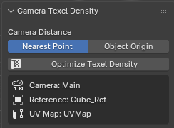

# Camera Texel Density

A Blender add-on I made for scenes with a fixed camera, where everything shares one texture atlas.

Objects further from the camera take up fewer pixels on screen, so they don't need as much texture
resolution as objects up close. This add-on scales each object's UVs based on how far it is from the
camera. Far objects get less space in the atlas and close objects get more, so that when you look
through the camera, the checker pattern looks the same size on everything.

Works in Blender 5.0 and above.

## Installing

1. Download `camera_texel_density-1.0.0.zip` from the Releases page (or from the `dist` folder).
2. In Blender, go to **Edit > Preferences > Get Extensions**.
3. Click the **⌄** in the top right and choose **Install from Disk…**, then pick the zip.

## How to use it

1. Make sure your scene has an active camera set up where you want it.
2. Select all the objects you want to optimise.
3. Make one of them the **active object**. This is your reference: its UVs stay exactly as they are,
   and everything else is scaled to match it.
4. Open the sidebar with **N** (in the 3D Viewport or the UV Editor) and go to the **UV Tools** tab.
5. Press **Optimize Texel Density**.

That's it. You can run it from Object Mode or Edit Mode, and Ctrl+Z undoes it.

It's safe to press the button more than once. If nothing has changed, nothing moves.

### Distance options

- **Nearest Point** (default): uses the part of the object that's closest to the camera. This is the
  right choice most of the time.
- **Object Origin**: uses the object's origin instead. Handy when the origin better represents
  where the object really sits.

## Good to know

- **It only changes the active UV map.** That's the one highlighted in the UV Maps list and shown in
  the UV Editor. The panel shows which UV map it will use.
- **It only scales, it doesn't move anything.** Each UV island scales from its own centre, so your
  layout stays where it is. Islands may overlap or go outside the 0–1 space afterwards.
- **Pack by hand afterwards, with island scaling turned off.** If you use Pack Islands with scaling
  on, it will undo the result.
- **Apply scale before unwrapping.** If an object was unwrapped with unapplied or non-uniform scale,
  its islands can end up with uneven density (or stretched checkers). The add-on keeps each object's
  islands at the sizes they were relative to each other, so fix those first (apply scale and
  re-unwrap, or use **UV > Average Islands Scale**).
- **Linked duplicates share one set of UVs.** If several selected objects use the same mesh, it's
  optimised for the one closest to the camera, and you'll get a warning.
- **Long objects that recede from the camera** (floors, long walls) are sized for their nearest
  visible part, so the far end ends up with a bit more detail than it needs.
- **Orthographic cameras:** distance doesn't affect size on screen, so it only evens out the texel
  density between objects.

Any warnings show in the status bar, and the full details print to the system console
(**Window > Toggle System Console**).
